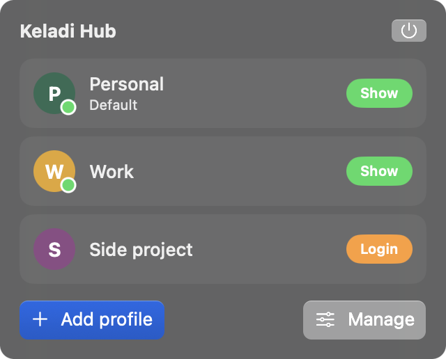
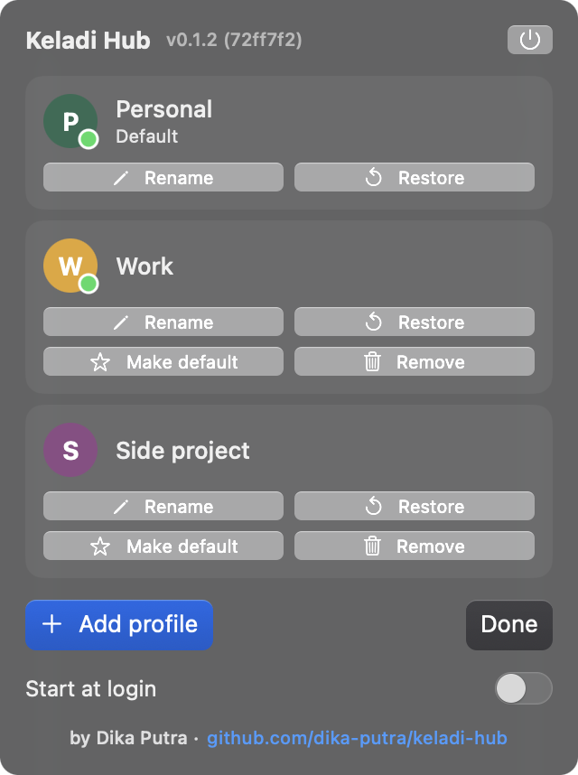

# Keladi Hub

A macOS menu bar app that manages and switches between Claude Desktop account profiles. Each profile has its own data folder, so signing in to one account never signs out another, and all of them can run at the same time.

Scope: today it only works with Claude Desktop. Other AI desktop apps are not supported, and it is not known which of them could be (many are native apps without a data-folder option).

Status: macOS only (native Swift). A Windows version is planned in a separate repository. Project notes, decisions, and research are in [PLAN.md](PLAN.md).

 

The screenshots use sample data (made with `KeladiHub --screenshot <folder>`), not real accounts.

## Project status

A personal project, shared as is. Issues are read when time allows, and no support is promised. It may break when Claude Desktop changes.

## Install

Download `Keladi-Hub-<version>-macOS.dmg` from the Releases page, open it, and drag `Keladi Hub.app` to the Applications folder. Requires macOS 14 or newer (Apple Silicon and Intel).

The app is **not signed with a Developer ID and not notarized by Apple**, so macOS blocks it the first time you open it. To open it: try to launch the app, then go to System Settings > Privacy & Security and click **Open Anyway**. If you would rather not trust a prebuilt binary, build it from source (see Build below). Each release page lists the SHA-256 checksum of the DMG.

## Uninstall

1. If you turned on **Start at login**, turn it off in the popup first. A login item that is left behind may stay listed in System Settings > General > Login Items (unverified); you can also remove it there by hand.
2. Quit Keladi Hub (the power button in the popup) and move `Keladi Hub.app` to the Trash.

This does not touch your Claude data. Your accounts stay signed in, and the profile list, the default profile name, and the backups are kept in `~/Library/Application Support/ClaudeProfileSwitcher/`. If you install Keladi Hub again, everything is still there. The default profile always exists, because it is built in.

To remove everything, also delete `~/Library/Application Support/ClaudeProfileSwitcher/`. That deletes the profile list, the default profile's custom name, and all Code session backups. The data folders `Claude-<id>` stay on disk, but nothing is linked to them any more, so you can delete them by hand if you no longer need those accounts. Never delete the `Claude` folder unless you want Claude Desktop itself to start over.

## Features

- A menu bar icon with no Dock icon and no main window. Click the icon to see a popup with your profiles.
- Click a profile to open Claude Desktop with that account. The popup closes by itself.
- A running profile shows a green dot and a **Show** button. Clicking it brings the existing window to the front (and restores it if it was minimized) instead of starting a second process.
- **Add profile**: enter a name, click **Login**, and sign in with the account you want. You only do this once.
- **Manage** mode has four buttons per profile: **Rename**, **Restore**, **Make default**, and **Remove**.
- The default profile is the account that opens when you start Claude from Spotlight or the Dock. You can rename it and you can move the default to another profile.
- Removing a profile deletes its local data, but its Code session history is saved first, as one backup per Claude account (merged, not replaced).
- **Restore** puts a saved Code session history back into any profile.
- **Start at login** is a switch at the bottom of the popup. It is off by default.
- The popup header shows the version and build id (for example `v0.1.1 (7f3843d)`). Include it in bug reports.

## Why use it

- It never touches your credentials. It does not read passwords or tokens. It only chooses which data folder Claude Desktop uses.
- No re-login when switching accounts. Each profile keeps its own session.
- Your existing Claude Desktop login needs no migration. The default profile uses the original folder.
- Light. Native Swift and SwiftUI, no third-party dependencies, no Electron.
- Deleting is guarded. Only `Claude-<id>` folders can be deleted, it is refused while that profile's Claude is running, and it is cancelled if the backup fails.
- Making a profile the default is a folder rename with rollback, not a copy.

## How it works

Claude Desktop is an Electron app. Keladi Hub launches it with `--user-data-dir=<folder>`, so each profile gets its own data folder:

| Profile | Data folder |
|---|---|
| Default | `~/Library/Application Support/Claude` |
| Others | `~/Library/Application Support/Claude-<id>` |

Folders are named with a random id, not the profile name, so renaming a profile never moves data.

The profile list is stored in `~/Library/Application Support/ClaudeProfileSwitcher/profiles.json`. Code session backups are in `~/Library/Application Support/ClaudeProfileSwitcher/Backups/<account id>/`. The `Library` folder is hidden in Finder; open it with Go > Go to Folder.

## Build

Requires Xcode (the command line tools are enough) and macOS 14 or newer.

```bash
./build.sh
open "build/Keladi Hub.app"
```

`build.sh` builds a universal binary with SwiftPM, creates `build/Keladi Hub.app` (menu bar only, `LSUIElement`), and signs it ad hoc. `./make-dmg.sh` runs `build.sh` and then packages the app into `build/Keladi-Hub-<version>-macOS.dmg`. Set `SIGN_ID` to a code signing identity to sign with your own certificate. To share the app widely you need your own Developer ID signing and notarization.

## Troubleshooting

**macOS says the app "cannot be opened" or "could not be verified".**
The app is not notarized. Try to open it once, then open System Settings > Privacy & Security, scroll down, and click **Open Anyway** next to Keladi Hub. Or build it from source.

**macOS removed the app and called it malware.**
An early development build that used the Accessibility API was deleted by macOS as malware. The reason was never shown, and the current code does not use Accessibility. Unsigned or ad-hoc signed apps can trigger this kind of warning. If it happens to you, do not turn off macOS protection to work around it. Build the app from source and check the code yourself, and please open an issue with the exact message macOS showed.

**The Start at login switch does not turn on.**
macOS may need you to approve it: open System Settings > General > Login Items and allow Keladi Hub. Registration can also fail when the app is not in the Applications folder, so move it there first. If it still fails, the popup shows the error macOS returned; please include it in an issue.

**The menu bar icon is not visible.**
The menu bar may be full, and macOS hides the icons that do not fit (this is common on Macs with a notch). Quit some other menu bar apps, or use a menu bar manager, and check again.

**A profile says "Login" even though I already signed in.**
The label only means that the profile's data folder does not exist yet, which is true until Claude has been opened with it once. After the first launch it changes to **Open**. The app does not check whether the login actually succeeded.

**Clicking Show does not bring back a minimized window.**
The first time, macOS may ask whether Keladi Hub is allowed to control Claude. Allow it, then click **Show** again. You can change this later in System Settings > Privacy & Security > Automation.

**"Claude is still open" when removing, restoring, or making a profile the default.**
Close that profile's Claude window first. For **Make default**, close every Claude window from every profile, because two data folders are swapped. A window can be hidden or minimized, so check the Dock and Mission Control.

**Restore did not bring back my sessions.**
The target profile must have been opened at least once and its Claude closed before you restore. Restore merges the backup into the profile's folder. Code sessions that worked inside a scratch workspace may not open, because those sessions store the absolute path of the old folder. Keladi Hub rewrites those paths, but this is not guaranteed.

**The app says "Remove the leftover folder Claude-swap-tmp first".**
A previous **Make default** was interrupted. Open `~/Library/Application Support` in Finder. If a folder named `Claude` is missing and `Claude-swap-tmp` exists, rename `Claude-swap-tmp` back to `Claude`. If both exist, do not delete anything yet: open an issue and describe what you see.

**Claude opens fullscreen for one profile and windowed for another.**
Claude Desktop appears to remember the window state per data folder, so each profile has its own (this is observed, not documented). Change it in that profile's window and it should stay.

**I opened Claude from Spotlight and got the wrong account.**
Spotlight and the Dock always open the default profile (the `Claude` folder). Use **Make default** in Manage mode to change which account that is, or open the account you want from Keladi Hub.

**I want to reset the profile list.**
Quit Keladi Hub and delete `~/Library/Application Support/ClaudeProfileSwitcher/profiles.json`. The `Claude-<id>` data folders and the backups are not touched, but the list starts empty and the old folders are no longer linked to a profile.

**Reporting a bug.**
Open an issue with the version line from the popup header, your macOS version, what you clicked, and what you expected.

## Limitations

- macOS only. Windows is not built or tested yet (the location of Claude.exe and a possible MSIX package are not checked).
- MCP configuration is per profile. A new profile starts without MCP servers.
- All Claude windows share one Dock icon, so you tell accounts apart by the account shown inside Claude.
- Login status is not detected (see the **Login** note above).
- Removing a profile deletes its Code session list and scratch workspace files. The transcripts in `~/.claude/projects` are shared by all profiles and are not deleted. Restoring the session list from a backup is proven; restoring scratch workspaces is not.
- Making a profile the default moves the folder that holds the login. Code sessions that used a scratch workspace store the absolute path of the old folder, so they may not open after a swap.
- It is not checked whether using several accounts fits Anthropic's Terms of Service. Read the terms before you use or share this.

## Project layout

- `Sources/KeladiHub/Store.swift`: model, `profiles.json`, process detection, launch and focus, remove, backup, restore, swap default.
- `Sources/KeladiHub/ContentView.swift`: the popup content.
- `Sources/KeladiHub/App.swift`: the menu bar icon and the popup panel, placed under the icon.
- `assets/`: the app icon and menu bar icon, plus `make-icons.swift`, which draws them (designs `captain`, `hub`, `pinwheel`, `leaf`).
- `build.sh`: builds and packages the `.app`.
- `make-dmg.sh`: builds the app and packages it as a DMG.

## About the name

The data folder `ClaudeProfileSwitcher` in `~/Library/Application Support` keeps the name of an earlier version of the app so that existing profiles and backups stay readable.

## License

MIT, see [LICENSE](LICENSE).

## Disclaimer

Keladi Hub is not an official Anthropic product and is not affiliated with, endorsed by, or sponsored by Anthropic. "Claude" is a trademark of Anthropic. This app only launches an already installed Claude Desktop with a different data folder.
